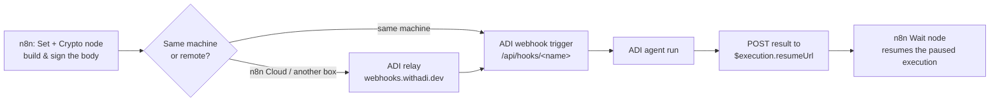

import Flags from '../../components/Flags.astro';

n8n pauses at a Wait node while ADI processes the message — classify it, draft a reply, summarize
a document — then resumes when ADI posts the result back.

It needs the [[marketplace#Do it|n8n marketplace package]], or n8n Cloud, plus the
[[marketplace#Do it|n8n-toolbox package]] if you also want an ADI agent to drive n8n in the other
direction — this guide is the n8n-calls-ADI half.

## The shape



n8n is the caller; ADI does the work asynchronously. The HTTP Request node that calls ADI gets
back an immediate ack — the workflow then **pauses** at a Wait node while the trigger keeps
running in the background. The real answer arrives later, as a separate HTTP call into the
paused execution: ADI posts to `$execution.resumeUrl`, and n8n resumes exactly where it left off.

## Prerequisites

- **ADI ≥1.40.0** for the same-machine variant — that's when a webhook trigger started getting
  the request's headers in `ADI_HEADERS_FILE`, which the HMAC check below reads.
- **Relay registration requires ADI 1.40.0 through the panel or 1.41.0 through the CLI.** 1.40.0
  shipped the relay and the panel's trigger editor, which registers an endpoint when you pick a
  relay there. `adi-mono triggers save --extra relay=...` — the way this guide's `triggers save`
  command below does it — registers one itself starting in 1.41.0; on 1.40.0, register from the
  panel once and manage the trigger with the CLI after. Enterprise: **2026.21.0** has the relay
  with panel registration, **2026.22.0** and later also register from the CLI.
- **An n8n instance** — the [[marketplace#Do it|n8n marketplace package]] (self-hosted, installs
  into its own project), or an n8n Cloud account. Nothing below is specific to either; only the
  URL the "Call ADI" node points at differs.
- `jq` and `openssl` on the machine ADI's trigger runs on — both are used by the trigger script
  below to check the signature and pull values out of the request.

## On the ADI side

### Secrets

Set three secrets per project, named here and read by name everywhere below:

| Secret | Used for |
| --- | --- |
| `N8N_HOOK_SECRET` | The webhook trigger's own `?secret=` query param — platform-enforced, checked before the trigger's own code ever runs. |
| `N8N_HMAC_SECRET` | The shared HMAC-SHA256 key. n8n's Crypto node signs the exact request body with it; the trigger recomputes the same HMAC and rejects a mismatch. |
| `N8N_RESUME_SECRET` | The value ADI sends back as a header on the resume call. n8n's Wait node requires it to match before resuming. |

```bash
adi-mono secrets set N8N_HOOK_SECRET   --project n8n --description "ADI webhook trigger's ?secret= gate"
adi-mono secrets set N8N_HMAC_SECRET   --project n8n --description "HMAC key n8n signs the request body with"
adi-mono secrets set N8N_RESUME_SECRET --project n8n --description "header value ADI sends on resume"
```

**Keep secrets out of transcripts and logs.** `triggers save --extra secret=...` (below) echoes
whatever you pass it, in its own confirmation line and later in `triggers show`/`list` — redirect
that command's output and redact the value if you keep it:

```bash
adi-mono triggers save n8n-to-adi --kind webhook --runtime sh --project n8n \
  --extra secret="$(adi-mono secrets read N8N_HOOK_SECRET --project n8n)" \
  --extra relay=public-eu --code "$(cat trigger.sh)" \
  >/tmp/out.txt 2>&1
sed "s/$(adi-mono secrets read N8N_HOOK_SECRET --project n8n)/<redacted>/" /tmp/out.txt
```

### The processor agent

A one-turn, [[Agents#Backends|harness:claude-sdk]] agent that reads one message and returns
JSON — the agent the webhook trigger below launches. **`--unattended`** matters here: this agent
is launched automatically, with nobody around to answer an `Ask` — see
[[Agents#When a run can't decide]].

```bash
adi-mono agents save n8n-processor \
  --llm <your-harness-claude-sdk-backend-id> --secret CLAUDE_CODE_OAUTH_TOKEN --project n8n \
  --tag n8n --unattended --max-turns 1 \
  --system-prompt 'You are given exactly one message as input. Output ONLY one line of minified
JSON, nothing else — no markdown fences, no explanation:
{"category":"billing"|"technical"|"feedback"|"other","sentiment":"positive"|"neutral"|"negative","summary":"<one sentence, at most 20 words>"}'
```

Swap the prompt for whatever your workflow needs — classify, summarize, draft a reply — the only
contract the rest of this guide depends on is "runs once, on `--wait`, and returns something
n8n can treat as the result."

### The webhook trigger <Flags>Expert area</Flags>

The `sh` trigger checks the HMAC header against `N8N_HMAC_SECRET`, runs `n8n-processor` on the
message, and posts the result back to the `resume_url` n8n sent it, with `N8N_RESUME_SECRET` as
a header.

```sh
#!/bin/sh
set -eu

ADI=/path/to/adi-mono
PROJECT=n8n
AGENT=n8n-processor
SIG_HEADER="x-adi-signature"   # hex HMAC-SHA256 of the raw request body

body=$(cat "$ADI_PAYLOAD_FILE")
sig_sent=$(jq -r --arg h "$SIG_HEADER" '.[$h] // ""' "$ADI_HEADERS_FILE")

hmac_secret=$("$ADI" secrets read N8N_HMAC_SECRET --project "$PROJECT")
sig_expected=$(printf '%s' "$body" | openssl dgst -sha256 -hmac "$hmac_secret" | awk '{print $NF}')
unset hmac_secret

if [ -z "$sig_sent" ] || [ "$sig_sent" != "$sig_expected" ]; then
  echo "REJECTED: bad or missing $SIG_HEADER — no callback sent, the n8n Wait node will time out" >&2
  exit 1
fi

input=$(printf '%s' "$body" | jq -r '.input // empty')
resume_url=$(printf '%s' "$body" | jq -r '.resume_url // empty')
[ -n "$input" ] && [ -n "$resume_url" ] || { echo "REJECTED: missing input or resume_url" >&2; exit 1; }

result=$("$ADI" agents run "$AGENT" --wait -m "$input")
printf '%s' "$result" | jq -e . >/dev/null 2>&1 || result=$(jq -n --arg r "$result" '{"raw": $r}')

# If n8n's own WEBHOOK_URL names a host this script can't resolve or reach directly — true of
# the n8n marketplace package, reachable only at the .adi hostname its own hive service proxies —
# resolve the real address yourself and keep the original hostname as a Host header, since n8n's
# webhook routing validates it against what it configured. See the WEBHOOK_URL bullet under Gotchas below.
resume_secret=$("$ADI" secrets read N8N_RESUME_SECRET --project "$PROJECT")
callback_body=$(jq -nc --argjson result "$result" '{result: $result}')

http_code=$(curl -s -o /dev/null -w "%{http_code}" -X POST "$resume_url" \
  -H "Content-Type: application/json" \
  -H "x-adi-resume-auth: $resume_secret" \
  --max-time 20 -d "$callback_body")
unset resume_secret

echo "resumed $resume_url -> HTTP $http_code"
```

```bash
adi-mono triggers save n8n-to-adi --kind webhook --runtime sh --project n8n \
  --extra secret="$(adi-mono secrets read N8N_HOOK_SECRET --project n8n)" \
  --extra relay=public-eu \
  --code "$(cat trigger.sh)"
```

`--extra relay=public-eu` is optional — leave it off and the trigger only ever answers on this
machine's own loopback front door. With it set, this one save registers an endpoint on ADI's
hosted relay (`POST /v1/endpoints`, done for you) and the command prints the resulting public URL:

```text
https://eu.webhooks.withadi.dev/h/wh_xxxxxxxxxxxxxxxxxxxx
```

That `/h/<id>` URL is what you give n8n for the relay-routed variant below — **one trigger
serves both variants**; you don't register a second one for the loopback case.

## On the n8n side

Five nodes after your workflow's own trigger: build the body, sign it, call ADI, wait for the
callback, then confirm the callback actually arrived.

### 1. Set — build the exact JSON string

n8n's HTTP Request node, left in its default "JSON" body mode, reserializes whatever you hand
it — which can change whitespace or key order and break a signature computed over a different
byte sequence. Build the string once, explicitly, and sign and send *that string*:

```js
{{ JSON.stringify({ input: $json.message, resume_url: $execution.resumeUrl }) }}
```

Assign that expression to a field (`body`) with a **Set** node.

### 2. Crypto — HMAC-SHA256 the body

A **Crypto** node, action `HMAC`, type `SHA256`, encoding `hex`, value `{{ $json.body }}`,
output field `signature`. Point its credential at a `Hmac Secret` field holding the value of
`N8N_HMAC_SECRET`.

### 3. HTTP Request — call ADI, with a Raw body

```json
{
  "method": "POST",
  "url": "http://127.0.0.1:8000/api/hooks/n8n-to-adi?secret=__ADI_HOOK_SECRET__",
  "sendHeaders": true,
  "headerParameters": { "parameters": [
    { "name": "x-adi-signature", "value": "={{ $json.signature }}" }
  ]},
  "sendBody": true,
  "contentType": "raw",
  "rawContentType": "application/json",
  "body": "={{ $json.body }}"
}
```

**Body type must be Raw, not JSON** — send the exact bytes signed in step 1; letting this node
re-encode the body breaks that. For the relay-routed variant, swap
the `url` for the `/h/<id>` URL `triggers save` printed, same `?secret=` query param.

### 4. Wait — "On Webhook Call", method POST, with a timeout

- Resume: **webhook**
- Incoming Authentication: **Header Auth**, a credential whose `Name` is `x-adi-resume-auth` and
  `Value` is `N8N_RESUME_SECRET`'s value
- **HTTP Method: POST** — the field defaults to GET; see [Gotchas](#gotchas) below for what
  happens if you leave it
- A time limit (five minutes is generous for a one-turn agent run) so the workflow doesn't hang
  forever if a callback never arrives

### 5. IF — check the result actually arrived

```js
{{ $json.body.result.category != null }}
```

(Swap `category` for whatever field your agent's output carries.) This is the node that tells a
real result from a timed-out Wait — see [Gotchas](#gotchas).

### The workflow, as one importable piece

Paste into n8n with **Import from File / Clipboard**, then: fill in `__ADI_HOOK_SECRET__` in the
"Call ADI" node's URL with the real secret value, and repoint the two credential references
("ADI HMAC", "ADI resume auth") at credentials holding `N8N_HMAC_SECRET` / `N8N_RESUME_SECRET`'s
real values — n8n never exports a credential's value, only its reference.

```json
{
  "name": "ADI round trip",
  "nodes": [
    { "id": "manual-trigger", "name": "When clicking 'Execute workflow'",
      "type": "n8n-nodes-base.manualTrigger", "typeVersion": 1, "position": [0, 300], "parameters": {} },
    { "id": "sample-message", "name": "Sample message", "type": "n8n-nodes-base.set",
      "typeVersion": 3.5, "position": [220, 300],
      "parameters": { "mode": "manual", "assignments": { "assignments": [
        { "id": "message-field", "name": "message", "type": "string",
          "value": "Hi, I was charged twice this month and need a refund." } ] } } },
    { "id": "build-signed-body", "name": "Build signed body", "type": "n8n-nodes-base.set",
      "typeVersion": 3.5, "position": [440, 300],
      "parameters": { "mode": "manual", "assignments": { "assignments": [
        { "id": "body-field", "name": "body", "type": "string",
          "value": "={{ JSON.stringify({ input: $json.message, resume_url: $execution.resumeUrl }) }}" } ] } } },
    { "id": "hmac-sign", "name": "HMAC sign body", "type": "n8n-nodes-base.crypto",
      "typeVersion": 2, "position": [660, 300],
      "parameters": { "action": "hmac", "type": "SHA256", "value": "={{ $json.body }}",
        "dataPropertyName": "signature", "encoding": "hex", "binaryData": false },
      "credentials": { "crypto": { "id": "__CREDENTIAL_ID__", "name": "ADI HMAC" } } },
    { "id": "call-adi", "name": "Call ADI", "type": "n8n-nodes-base.httpRequest",
      "typeVersion": 4.5, "position": [880, 300],
      "parameters": { "method": "POST",
        "url": "http://127.0.0.1:8000/api/hooks/n8n-to-adi?secret=__ADI_HOOK_SECRET__",
        "sendHeaders": true, "specifyHeaders": "keypair",
        "headerParameters": { "parameters": [
          { "name": "x-adi-signature", "value": "={{ $json.signature }}" } ] },
        "sendBody": true, "contentType": "raw", "rawContentType": "application/json",
        "body": "={{ $json.body }}", "options": {} } },
    { "id": "wait-for-adi", "name": "Wait for ADI result", "type": "n8n-nodes-base.wait",
      "typeVersion": 1.1, "position": [1100, 300],
      "parameters": { "resume": "webhook", "incomingAuthentication": "headerAuth",
        "limitWaitTime": true, "limitType": "afterTimeInterval",
        "resumeAmount": 5, "resumeUnit": "minutes", "httpMethod": "POST", "options": {} },
      "credentials": { "httpHeaderAuth": { "id": "__CREDENTIAL_ID__", "name": "ADI resume auth" } } },
    { "id": "check-result", "name": "Check result arrived", "type": "n8n-nodes-base.if",
      "typeVersion": 2, "position": [1320, 300],
      "parameters": { "conditions": { "options": { "caseSensitive": true, "typeValidation": "strict" },
        "conditions": [ { "leftValue": "={{ $json.body.result.category }}",
          "rightValue": "", "operator": { "type": "string", "operation": "notEmpty" } } ],
        "combinator": "and" } } }
  ],
  "connections": {
    "When clicking 'Execute workflow'": { "main": [[ { "node": "Sample message", "type": "main", "index": 0 } ]] },
    "Sample message": { "main": [[ { "node": "Build signed body", "type": "main", "index": 0 } ]] },
    "Build signed body": { "main": [[ { "node": "HMAC sign body", "type": "main", "index": 0 } ]] },
    "HMAC sign body": { "main": [[ { "node": "Call ADI", "type": "main", "index": 0 } ]] },
    "Call ADI": { "main": [[ { "node": "Wait for ADI result", "type": "main", "index": 0 } ]] },
    "Wait for ADI result": { "main": [[ { "node": "Check result arrived", "type": "main", "index": 0 } ]] }
  },
  "settings": { "executionOrder": "v1" }
}
```

## Same machine, or through the relay

**Same machine** — n8n's HTTP Request node calls ADI directly: `http://127.0.0.1:<port>/api/hooks/n8n-to-adi?secret=...`.
Use the actual loopback port your ADI front door binds, not a `.adi` hostname — a caller outside
ADI's own front door, which a plain n8n process is, can't resolve one.

**n8n Cloud, or n8n on a different box** — point the same node at the `/h/<id>` URL the trigger
save printed instead. ADI never needs an inbound port, a firewall rule, or a DNS record for this:
it dials the relay itself, on a long-poll, and the relay replays a delivery into the exact same
`/api/hooks/n8n-to-adi` dispatch — the trigger's own code can't tell which path a call arrived by.
The resume callback is unaffected either way: it always goes straight to n8n's own address, taken
from `$execution.resumeUrl`.

### The relay's limits <Flags>Expert area</Flags> <Flags>Enterprise interest</Flags>

ADI's hosted public relay (`public-eu` / `public-us`) is deliberately narrow: **256 KiB** max
body, **60 requests/minute** per endpoint, and **5 minutes default / 15 minutes max retention**
for an unclaimed delivery. The one that matters most: **a queued delivery is deleted the instant
ADI's poller claims it — no acknowledgement, no redelivery.** If ADI's own `pull` loop is down or
crashes mid-batch, that one delivery is gone for good. The Wait node's own timeout isn't a
defense against that loss — it's what keeps the workflow from hanging forever when a delivery
never shows up. An Enterprise licence gets higher limits (`enterprise-eu`/`enterprise-us`); a
self-hosted relay sets its own. See [[triggers#An inbound webhook|Triggers]] for the loopback-only
default this relay exists to route around.

### The security model

Two independent layers protect this round trip, neither of which depends on the other:

- **The `?secret=` query param** is checked by the platform itself, before the trigger's own
  script runs at all — a wrong or missing value never reaches your code.
- **The HMAC header**, checked inside the trigger script against `ADI_PAYLOAD_FILE` and
  `ADI_HEADERS_FILE`, proves the *exact bytes* n8n sent weren't altered or replayed from a
  different request — the query param only proves "knew the URL."

On the relay path, add: an unguessable `/h/<id>` endpoint id is the sender's only defense against
a stranger finding it, and the relay seals every delivery to this node's own key the instant it
arrives — the relay operator (ADI, if you're on the hosted tier) can't read the body, only that a
delivery of some size happened at some time.

## Gotchas

- **The Wait node's "On Webhook Call" HTTP method defaults to GET.** A POST callback into a node
  still set to GET 404s with "does not contain a waiting webhook with a matching path/method" —
  set `httpMethod` to `POST` explicitly; nothing in the UI flags that the method is part of the
  match.
- **A timed-out Wait node is not a failure in n8n.** When the timeout elapses with no resume
  call, the execution still finishes with status `success`, and whatever runs after the Wait node
  sees the Wait node's *own pre-wait input* — here, the HTTP Request node's ack — not an error and
  not `null` at the top level. A workflow with no explicit check for the result it expected (the
  IF node above) will silently behave as if the call to ADI succeeded with empty data.
- **Expect up to ~60 extra seconds of latency on top of your configured timeout**, on a
  single-instance n8n. n8n discovers newly waiting executions on a periodic sweep, not the instant
  the wait begins — a 20-second timeout can resolve closer to 80 seconds in practice. Don't
  promise a workflow "exactly N seconds."
- **The HMAC must be computed over the exact bytes sent, not "the body" in the abstract.** Build
  the JSON string once (step 1 above), sign that string, and send it as the HTTP Request node's
  **Raw** body type — JSON body mode reserializes and can change whitespace or key order, breaking
  verification against what was actually signed.
- **Make sure ADI can reach n8n's `WEBHOOK_URL`.** `$execution.resumeUrl` is built from n8n's own
  configured public URL — if that names a host or port the machine running your ADI trigger can't
  actually resolve or connect to (common when n8n runs behind a reverse proxy, a container's own
  DNS, or a hostname that only resolves inside a different process's context), the resume call
  fails to connect or 404s on arrival, and the Wait node just times out with no error on either
  side to point at. Resolve the real address yourself inside the trigger script and send the
  original hostname back as a `Host` header if n8n's own webhook routing checks it.
- **Redact `triggers save --extra secret=...`'s own output.** It's a generic passthrough, not
  specifically the secrets system, so it echoes whatever value you pass in its confirmation line
  and in later `triggers show`/`list` calls — pipe to a file and redact, as shown above, rather
  than letting it land in a terminal scrollback or a transcript.
- **n8n's Public API can't run a workflow at all**, not even a Manual Trigger one — only the UI's
  own internal endpoint can, and that needs a session cookie, not an API key. Fine for a person
  clicking the button; if you're testing this headlessly, a Schedule or Webhook trigger node is
  the better choice than Manual.

## See also

[[triggers|Triggers]] for the webhook/background/event trigger shapes this builds on,
[[secrets|Secrets]] for how the three secrets above are stored, [[agents|Agents]] for backends and
run caps, [[marketplace|Marketplace]] for the n8n and n8n-toolbox packages.
